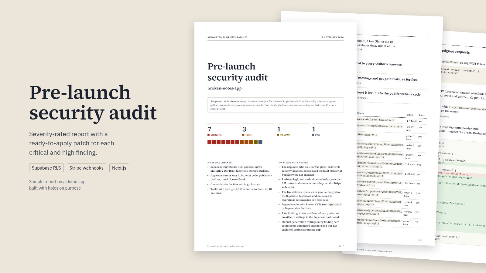

# prelaunch-audit-report

A command-line tool that runs security scanners over a Next.js or React app on Supabase and Stripe and turns
their output into one report you can hand to a founder: severity-rated findings with CWE ids, plain-language
risks, effort estimates and a patch for each finding it knows how to fix. Output is JSON, HTML and an A4 PDF.

I built it as a personal project. The [sample report](examples/sample-report/report.pdf) is a run on
broken-notes-app, a small demo app I wrote with security holes on purpose for
[supabase-scanner-bench](https://github.com/atokim4/supabase-scanner-bench). It is not a client audit.



## Run it

Node 22.18 or newer, git, and Google Chrome or Chromium for the PDF.

```bash
git clone https://github.com/atokim4/prelaunch-audit-report && cd prelaunch-audit-report
npm ci
node src/cli.ts path/to/your-app --out audit-out
```

`audit-out/` then holds `report.pdf`, `report.html`, `findings.json` and `patches/PA-01.diff`, …

To also check the deployed site, build [apify-launch-audit](https://github.com/atokim4/apify-launch-audit)
once (`npm ci && npm run build` in its folder) and pass its CLI:

```bash
node src/cli.ts path/to/your-app --url https://your-app.example --launch-audit-cli ../apify-launch-audit/dist/cli.js
```

| Option                       | What it does                                                 |
| ---------------------------- | ------------------------------------------------------------ |
| `--out <dir>`                | Output folder (default `audit-out`)                          |
| `--url <url>`                | Also scan the live site                                      |
| `--launch-audit-cli <path>`  | apify-launch-audit `dist/cli.js` (or set `LAUNCH_AUDIT_CLI`) |
| `--launch-audit-json <file>` | Use a saved `launch-audit <url> --json` run instead          |
| `--format json,html,pdf`     | Pick outputs (default all three)                             |
| `--note <text>`              | A line on the cover, for scope or a sample notice            |
| `--name <name>`              | App name on the report (default: `name` in package.json)     |
| `--date <ISO date>`          | Fixed report date, for reproducible output                   |

Set `CHROME_PATH` if Chrome is somewhere unusual, and `CHROME_NO_SANDBOX=1` when Chrome runs inside a
container that has no sandbox.

## What it checks

### Repository

Checked with [vibe-preflight](https://github.com/atokim4/vibe-preflight) 1.3.0 (vendored, SHA-256
pinned, see [vendor/vibe-preflight](vendor/vibe-preflight/README.md)):

| Rule                                                                                   | Report severity                                                | CWE  |
| -------------------------------------------------------------------------------------- | -------------------------------------------------------------- | ---- |
| `rls-disabled`: table in `public` with Row Level Security off                          | Critical                                                       | 862  |
| `rls-permissive-policy`: `using (true)` / `with check (true)`                          | Critical on writes, High on reads                              | 863  |
| `rls-update-privileged-column`: users can update their own `plan` / `role` / `credits` | High                                                           | 915  |
| `view-bypasses-rls`: view without `security_invoker`                                   | High                                                           | 863  |
| `auth-users-exposed`: view over `auth.users` in `public`                               | Critical                                                       | 359  |
| `definer-function-anon`: SECURITY DEFINER function anon can call over RPC              | Critical (explicit grant), High (default grant)                | 269  |
| `definer-search-path`: SECURITY DEFINER function without `set search_path`             | Medium                                                         | 426  |
| `storage-public-bucket`: public bucket                                                 | Critical when anyone can list it, else Medium                  | 552  |
| `rls-no-policy`: RLS on and no policies (safe, but reads come back empty)              | Low                                                            | none |
| `server-secret-in-client`: service role or Stripe secret in browser code               | Critical                                                       | 668  |
| `public-env-secret`: secret behind `NEXT_PUBLIC_` / `VITE_` / `EXPO_PUBLIC_`           | Critical or High                                               | 668  |
| `stripe-webhook-unverified`: webhook without `constructEvent`                          | Critical                                                       | 345  |
| `stripe-webhook-parsed-body`: signature checked against a parsed body                  | Medium                                                         | 345  |
| `env-file-committed`: `.env` file with values tracked by git                           | Critical, or Low when it holds only demo keys or public values | 312  |

### Credentials

A built-in scanner reads the files git would publish and every commit in
`git log -p --all`. It knows ten key formats with fixed prefixes (Stripe secret and webhook keys, Supabase
secret keys and service_role JWTs, AWS, GitHub, Anthropic, OpenAI, Slack, private key blocks). It skips
placeholders, anon JWTs and the Supabase CLI's local demo key, and masks every value it reports. A key still in
the files is Critical; one that only lives in history is High; Stripe test keys are Low. It does not look for
generic `password = "..."` strings, so it misses those on purpose.

### Live site (optional)

apify-launch-audit checks HTTPS and HSTS, security headers, cookie flags, keys in
the JavaScript bundles, public source maps, exposed `.env` or `.git`, robots and sitemap, slow responses. These
findings keep the severity that tool gives them.

## What it does not check

The cover of every report lists this too:

- Business logic and authorization inside your own API routes and server actions (beyond the Stripe webhook).
- The live database. Policies or grants changed in the Supabase dashboard and never saved as migrations are
  invisible to a repo scan.
- Dependencies with known CVEs. Use `npm audit` or Dependabot.
- Rate limiting, abuse protection, and the auth and email settings in the Supabase dashboard.
- Manual penetration testing. Every finding comes from an automated scanner; nothing was exploited against a
  running app.

## Severity rubric

A rule gets the first level that fits:

1. **Critical**: anyone on the internet, without an account, can read private data, change data, take
   money-related actions or get a key that does those things.
2. **High**: a signed-in user can reach other users' data or give themselves something they did not pay for, or
   private data is exposed under a condition the scanner cannot rule out.
3. **Medium**: a missing safeguard that makes another bug easier to exploit or worse, or a bug that breaks a
   feature in a way that fails closed.
4. **Low**: hygiene and launch polish.

Two rules that flag the same object (for example a view over `auth.users` that also lacks `security_invoker`)
become one finding, named after the more specific rule, with the other listed under "also flagged by".

## Patches

For 11 rules the tool writes a fix: a new Supabase migration for the database rules, or an edit of the file for
the code rules (the Stripe webhook gets raw-body signature checking with `constructEventAsync`, a public secret
variable is renamed everywhere and its module marked `server-only`, a service role key in a client component is
swapped for the anon key). Each patch is a unified diff that applies with `git apply` from the repo root, and the
tool runs `git apply --check` on it against the code as scanned before it calls the patch verified. Every patch
also lists what it cannot know, such as "this admin screen now sees only the rows its user may see".

Read each one before applying it: the tool writes them from the code alone and cannot know your intent.

## Results on the demo app

`test/fixtures/broken-notes-app` is a copy of the target app from supabase-scanner-bench, with its ground truth
in `broken-notes-app.holes.json`: 12 seeded holes and 7 controls that are done right.

- All 12 holes are reported and none of the 7 controls is: 7 Critical, 3 High, 1 Medium, 1 Low.
- That 12 of 12 is not an independent score. I wrote the vibe-preflight checks that catch these holes after
  building the bench, so the app tests exactly what the scanner knows. On someone else's app expect misses.
- The demo app has no committed secrets, so the bench says nothing about the credential scanner. Its tests use
  keys built at runtime in temporary git repos.
- All 10 Critical and High findings, plus the Medium one, come with a verified patch. The test suite applies every
  patch to a copy of the app, runs all migrations in Postgres
  ([PGlite](https://github.com/electric-sql/pglite) with a small Supabase stand-in for roles, `auth` and
  `storage`) and checks the behaviour: anon gets no rows from `audit_log`, a third user cannot read a
  conversation, a user cannot set their own `plan` but can change `display_name`, the admin RPC and user
  directory are closed to the API roles, the view runs as the caller, the invoices bucket is private. vibe-preflight
  then reports no errors on the patched app.
- `scripts/typecheck-patched-app.sh` installs the app's real dependencies (Next.js 15.5, Stripe 19.1,
  supabase-js 2.58) and type-checks the patched code. It passes. It needs network, so it is not part of
  `npm test`.

Regenerate the sample with `npm run sample`.

## Development

```bash
npm ci
npm run check   # tsc, eslint, prettier, vitest (38 tests)
```

The code runs as TypeScript directly on Node's type stripping, with no build step.

```
src/cli.ts              options, writes the output folder
src/audit.ts            runs the scanners, normalises, adds patches
src/scanners/           vibe-preflight (subprocess), launch-audit (subprocess or saved JSON), secrets
src/rubric.ts           severity, CWE, effort and plain-language text per rule
src/normalize.ts        rubric + dedupe + ordering + ids
src/patches/            fixers per rule, SQL reading, diff and git apply --check
src/report/             HTML template and the PDF print (playwright-core + Chrome)
```

## Credits and licence

MIT, see [LICENSE](LICENSE). The vendored vibe-preflight bundle is MIT. Fonts embedded in the report are Source
Serif 4 and IBM Plex (SIL Open Font License, via Fontsource). PGlite is Apache-2.0 / PostgreSQL licensed.
