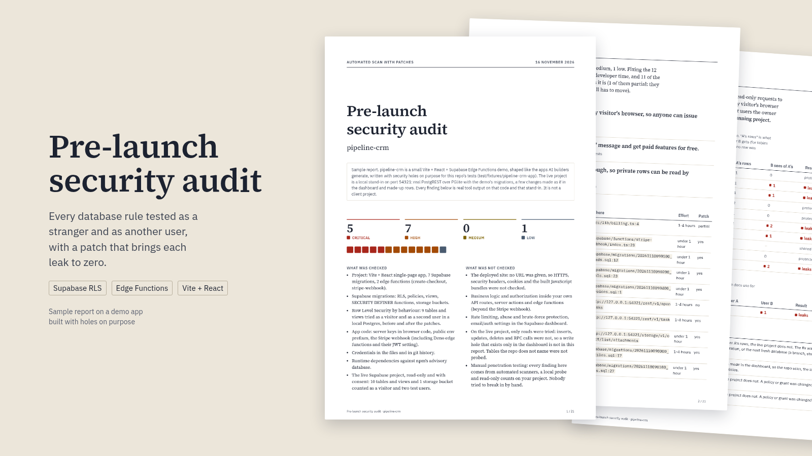

# prelaunch-audit-report

A command-line tool that audits a Next.js or Vite/React app on Supabase and Stripe and writes one report you
can hand to a founder: severity-rated findings with CWE ids, plain-language risks, effort estimates and a patch
for each finding it knows how to fix. Output is JSON, HTML and an A4 PDF.

Static checkers, including the one bundled here, read the policy text. This tool also runs your migrations in a local Postgres
([PGlite](https://github.com/electric-sql/pglite)), gives one test user a row in every table and then tries to
read and change that row as a visitor with no account and as a second user. A finding says what got through
("user B could select 1 of 1 of user A's rows"). After the patches are written, the same tries run once more with
all of them applied, and the report shows how many leaks are left (0 on both demo apps).

I built it as a personal project. The two sample reports below are runs on demo apps I wrote with security
holes on purpose. They are not client audits.

| Sample                                                                            | App shape                                                                   |
| --------------------------------------------------------------------------------- | --------------------------------------------------------------------------- |
| [Vite + Supabase Edge Functions](examples/sample-report-vite-supabase/report.pdf) | React SPA, migrations, Deno edge functions (the shape AI builders generate) |
| [Next.js App Router](examples/sample-report/report.pdf)                           | Next.js 15, route handlers, migrations, storage buckets                     |



## Run it

Node 22.18 or newer, git, and Google Chrome or Chromium for the PDF.

```bash
git clone https://github.com/atokim4/prelaunch-audit-report && cd prelaunch-audit-report
npm ci
node src/cli.ts path/to/your-app --out audit-out
```

`audit-out/` then holds `report.pdf`, `report.html`, `findings.json` and `patches/PA-01.diff`, …

To also check the deployed site, build [apify-launch-audit](https://github.com/atokim4/apify-launch-audit)
once (`npm ci && npm run build` in its folder) and pass its CLI:

```bash
node src/cli.ts path/to/your-app --url https://your-app.example --launch-audit-cli ../apify-launch-audit/dist/cli.js
```

| Option                       | What it does                                                 |
| ---------------------------- | ------------------------------------------------------------ |
| `--out <dir>`                | Output folder (default `audit-out`)                          |
| `--url <url>`                | Also scan the live site                                      |
| `--launch-audit-cli <path>`  | apify-launch-audit `dist/cli.js` (or set `LAUNCH_AUDIT_CLI`) |
| `--launch-audit-json <file>` | Use a saved `launch-audit <url> --json` run instead          |
| `--format json,html,pdf`     | Pick outputs (default all three)                             |
| `--note <text>`              | A line on the cover, for scope or a sample notice            |
| `--name <name>`              | App name on the report (default: `name` in package.json)     |
| `--date <ISO date>`          | Fixed report date, for reproducible output                   |
| `--skip-npm-audit`           | Don't run `npm audit` (it needs network)                     |

Set `CHROME_PATH` if Chrome is somewhere unusual, and `CHROME_NO_SANDBOX=1` when Chrome runs inside a
container that has no sandbox.

## What it checks

The tool first works out the project shape (Next.js App or Pages Router, Vite + React SPA, number of
migrations, each Supabase Edge Function and its `verify_jwt` setting from `supabase/config.toml`) and prints it on
the cover.

### Row Level Security, by behaviour

`supabase/migrations/*.sql` are loaded in order into PGlite on top of a small stand-in for the parts of Supabase
they rely on (the `anon`, `authenticated` and `service_role` roles, `auth.users`, `auth.uid()`, storage tables,
Supabase's default grants, the realtime publication, Supabase's internal roles and a `cron.schedule` stand-in).
Extensions PGlite ships (`uuid-ossp`, `pgcrypto`, `pg_trgm`, `citext` and others) are loaded when a migration asks
for them; platform-only ones such as `pg_net` or `pg_cron` are stepped over and named in the appendix. Two users
are created. Every table in `public` gets one row owned by user A. Owner columns are the ones that reference
`auth.users`, or are called `user_id`, `owner_id` and similar; a table without one that has a foreign key to an
owned table (messages of a project) belongs to the parent row's owner. Parents are seeded first, and unique
columns get fresh values. Then, each in a transaction that is rolled back:

- as a visitor with only the public key: select, insert a row in A's name, update and delete A's rows;
- as user B: the same four on user A's rows;
- as user A: write a different value into their own `plan`, `role`, `credits`, `stripe_*` and similar columns,
  counting it only when the stored value really changed (a trigger that resets or rejects it counts as blocked);
- for views: select as the visitor and as user B.

Only a permission error or an RLS violation counts as "blocked". A try that fails for another reason (a check
constraint or trigger rejecting the test values) is shown as "?" and proves nothing either way.

What gets through decides the severity. A visitor reaching user rows is Critical. User B reaching A's rows, or
A upgrading their own plan, is High. A table that belongs to no user at all (a price list) may be readable by
everyone; only writes to it count. When no static rule explains a leak, it becomes its own finding pointing at the policy that
let it through. The two most common shapes it catches that policy linters pass are `using (auth.role() =
'authenticated')` on a select and `with check (auth.uid() is not null)` on an insert.

If a migration still does not load in PGlite (`vector` or `postgis`, which this PGlite build doesn't have, for
example), the report says so and only the static checks run.

### Repository rules

Checked with [vibe-preflight](https://github.com/atokim4/vibe-preflight) 1.3.0 (vendored, SHA-256
pinned, see [vendor/vibe-preflight](vendor/vibe-preflight/README.md)), then adjusted by the probe where it ran:

| Rule                                                                                                                         | Report severity                                                                                                                                                             | CWE  |
| ---------------------------------------------------------------------------------------------------------------------------- | --------------------------------------------------------------------------------------------------------------------------------------------------------------------------- | ---- |
| `rls-disabled`: table in `public` with Row Level Security off                                                                | Critical                                                                                                                                                                    | 862  |
| `rls-permissive-policy`: `using (true)` / `with check (true)`                                                                | Critical on writes, High on reads; Critical if visitors really read user rows; Low for a select policy on a table that belongs to no user, when every write try was refused | 863  |
| `rls-update-privileged-column`: users can update their own `plan` / `role` / `credits`                                       | High                                                                                                                                                                        | 915  |
| `view-bypasses-rls`: view without `security_invoker`                                                                         | High, Critical if visitors really read user rows                                                                                                                            | 863  |
| `auth-users-exposed`: view over `auth.users` in `public`                                                                     | Critical                                                                                                                                                                    | 359  |
| `definer-function-anon`: SECURITY DEFINER function anon can call over RPC                                                    | Critical (explicit grant), High (default grant)                                                                                                                             | 269  |
| `definer-search-path`: SECURITY DEFINER function without `set search_path`                                                   | Medium                                                                                                                                                                      | 426  |
| `storage-public-bucket`: public bucket                                                                                       | Critical when anyone can list it, else Medium                                                                                                                               | 552  |
| `rls-no-policy`: RLS on and no policies (safe, but reads come back empty)                                                    | Low                                                                                                                                                                         | none |
| `server-secret-in-client`: service role or Stripe secret in browser code                                                     | Critical                                                                                                                                                                    | 668  |
| `public-env-secret`: secret behind `NEXT_PUBLIC_` / `VITE_` / `EXPO_PUBLIC_`                                                 | Critical or High                                                                                                                                                            | 668  |
| `stripe-webhook-unverified`: webhook without `constructEvent` (route handlers and Deno edge functions)                       | Critical                                                                                                                                                                    | 345  |
| `stripe-webhook-parsed-body`: signature checked against a parsed body                                                        | Medium                                                                                                                                                                      | 345  |
| `env-file-committed`: `.env` file with values tracked by git                                                                 | Critical, or Low when it holds only demo keys or public values                                                                                                              | 312  |
| `stripe-webhook-jwt-gate`: webhook edge function that checks the signature but keeps `verify_jwt = true`, so Stripe gets 401 | Medium (fails closed)                                                                                                                                                       | none |

### Credentials

A built-in scanner reads the files git would publish and every commit in
`git log -p --all`. It knows ten key formats with fixed prefixes (Stripe secret and webhook keys, Supabase
secret keys and service_role JWTs, AWS, GitHub, Anthropic, OpenAI, Slack, private key blocks). It skips
placeholders, anon JWTs and the Supabase CLI's local demo key, and masks every value it reports. A key still in
the files is Critical; one that only lives in history is High; Stripe test keys are Low. It does not look for
generic `password = "..."` strings, so it misses those on purpose.

### Dependencies

`npm audit --json --package-lock-only --omit=dev` when the repo has a `package-lock.json`. One finding per
package that carries an advisory (packages listed only because they depend on it are folded in), rated one level
below npm's rating, because the advisory says the version is affected, not that your code reaches the affected
function. Without a lockfile or network the report says dependencies were not checked.

### Live site (optional)

apify-launch-audit checks HTTPS and HSTS, security headers, cookie flags, keys in
the JavaScript bundles, public source maps, exposed `.env` or `.git`, robots and sitemap, slow responses. These
findings keep the severity that tool gives them.

## What it does not check

The cover of every report lists this too:

- Business logic and authorization inside your own API routes, server actions and edge functions (beyond the
  Stripe webhook).
- The live database. Policies or grants changed in the Supabase dashboard and never saved as migrations are
  invisible to a repo scan, and the probe runs your migrations locally, never against your project.
- Rate limiting, abuse protection, and the auth and email settings in the Supabase dashboard.
- Manual penetration testing. Every finding comes from an automated scanner or the local probe; nothing was
  tried against your running app.

The probe also has limits worth knowing: it seeds one row per table with guessed values, so a table whose check
constraints or triggers reject those values is listed as "not tried"; it tests the two API roles, not
`service_role`; and functions called over `/rest/v1/rpc/` are checked statically, not called.

## Severity rubric

A rule gets the first level that fits:

1. **Critical**: anyone on the internet, without an account, can read private data, change data, take
   money-related actions or get a key that does those things.
2. **High**: a signed-in user can reach other users' data or give themselves something they did not pay for, or
   private data is exposed under a condition the scanner cannot rule out.
3. **Medium**: a missing safeguard that makes another bug easier to exploit or worse, or a bug that breaks a
   feature in a way that fails closed.
4. **Low**: hygiene and launch polish.

Two rules that flag the same object (for example a view over `auth.users` that also lacks `security_invoker`)
become one finding, named after the more specific rule, with the other listed under "also flagged by".

## Patches

For 13 rules the tool writes a fix: a new Supabase migration for the database rules, or an edit of the file for
the code rules. Each patch is a unified diff that applies with `git apply` from the repo root, and the tool runs
`git apply --check` on it against the code as scanned before it calls the patch verified. Some of them:

- A leak only the probe found: each policy that let it through is rewritten in place (same name) so the owner
  column must equal `(select auth.uid())`.
- Stripe webhook in a Next.js route handler: raw body plus `constructEventAsync`.
- Stripe webhook in a Supabase Edge Function (Deno): raw body plus `constructEventAsync` with
  `Stripe.createSubtleCryptoProvider()`, because Deno has no Node crypto. The test suite runs the bench app's
  function in Node, with stand-ins for `serve`, `Deno.env` and the Supabase client, before and after the patch,
  and signs events with the real Stripe package: the original upgrades a plan for an unsigned POST, the patched
  one returns 400 for a missing or forged signature and 200 for a signed event.
- `stripe-webhook-jwt-gate`: sets `verify_jwt = false` for that function in `supabase/config.toml`.
- A secret behind `VITE_` or `NEXT_PUBLIC_` in browser code: renamed everywhere so the next build no longer ships
  it. That patch is marked **partial** in the report, because the code that used the key still runs in the
  browser and has to move to an edge function or server route. A mechanical move would keep trusting whatever
  arguments the browser sends, so the tool leaves that to a person and says so.

"Verified" on a patch means `git apply --check` passed; it is not a test of the result. For the database the
re-run of the probe is that test: after all patches are drafted, the probe runs again on the migrations with
every verified patch applied, and each finding shows how many leaks are left. Every patch also lists what it cannot know, such as "check that owner_id
is who should have access". Read each one before applying it.

## Results on the demo apps

Both apps live in `test/fixtures` with their ground truth next to them. Holes are seeded on purpose; controls are
done right and must not be flagged at Medium or above.

**pipeline-crm-app** (Vite + React SPA, 7 migrations, 2 Deno edge functions): 9 holes, 7 controls.

- All 9 holes are reported: 5 Critical, 4 High, plus 1 Low (the public price list, see below).
- 2 of the 9 are found only by the probe: a select policy that checks `auth.role() = 'authenticated'` (any
  signed-in user reads every deal) and an insert policy that checks `auth.uid() is not null` (user B writes rows
  in user A's name). vibe-preflight passes both.
- The price list control has an open read policy. vibe-preflight rates that High; the probe finds no owner column
  and no write getting through, so the report rates it Low ("confirm it is meant to be public"). No control is
  flagged at Medium or above.
- All 9 Critical and High findings have a verified patch; one of them is partial (the Vite secret). With the
  patches applied the probe finds 0 leaks in all 9 tables and views, checked once inside the audit and once more by
  the test suite from the patched files.

**broken-notes-app** (Next.js App Router, 13 migrations): 12 holes, 7 controls, originally written for an earlier
benchmark of mine.

- All 12 holes are reported and none of the 7 controls is: 9 Critical, 1 High, 1 Medium, 1 Low. Two findings
  went from High to Critical once the probe ran, because a visitor without an account really read user rows
  through them (`messages` with `using (true)` and the `recent_notes` view).
- All Critical and High findings and the Medium one come with a verified patch. The suite applies every patch to a
  copy, re-runs all migrations and checks behaviour: anon gets no rows from `audit_log`, a third user cannot read a
  conversation, a user cannot set their own `plan` but can change `display_name`, the admin RPC and user
  directory are closed to the API roles, the view runs as the caller, the invoices bucket is private.
- `scripts/typecheck-patched-app.sh` installs that app's real dependencies (Next.js 15.5, Stripe 19.1,
  supabase-js 2.58) and type-checks the patched code. It needs network, so it is not part of `npm test`.

Read these numbers for what they are. I wrote both demo apps and the scanner rules, so the apps test what the
tools know, and 9 of 9 or 12 of 12 is not an independent detection rate. On someone else's app expect misses.
Neither app has committed secrets, so they say nothing about the credential scanner; its tests use keys built at
runtime in temporary git repos.

Regenerate the samples with `npm run sample` and `npm run sample:vite`.

## Development

```bash
npm ci
npm run check   # tsc, eslint, prettier, vitest (77 tests, about a minute: each probe boots Postgres in WASM)
```

The code runs as TypeScript directly on Node's type stripping, with no build step.

```
src/cli.ts              options, writes the output folder
src/audit.ts            project shape, scanners, probe, normalise, patches, re-probe
src/shape.ts            framework, migrations, edge functions and verify_jwt
src/probe/              the RLS probe (PGlite) and the Supabase stand-in it loads first
src/scanners/           vibe-preflight (subprocess), secrets, npm audit, launch-audit, probe → findings
src/rubric.ts           severity, CWE, effort and plain-language text per rule
src/normalize.ts        rubric + dedupe + ordering + ids
src/patches/            fixers per rule, SQL reading, diff and git apply --check
src/report/             HTML template and the PDF print (playwright-core + Chrome)
```

## Credits and licence

MIT, see [LICENSE](LICENSE). The vendored vibe-preflight bundle is MIT. Fonts embedded in the report are Source
Serif 4 and IBM Plex (SIL Open Font License, via Fontsource). PGlite is Apache-2.0 / PostgreSQL licensed. The
Stripe npm package (MIT) is a dev dependency, used only to sign test events.
